# 课程目标

- 了解常见web框架分类
- 掌握Django框架使用

# Python中常见的web框架

- Django 大而全，内部提供的组件比较丰富，可以直接调用
- Flask ,FastAPI 小而精，内部提供的组件比较少，需要根据需求安装第三方组件
- Tornado 小而精，内部提供的组件比较少，需要根据需求安装第三方组件

# Django 简介

## 基本介绍

- Django 是一个用于构建 Web 应用程序的高级 Python Web 框架。
- Django 提供了一套强大的工具和约定，使得开发者能够快速构建功能齐全且易于维护的网站。
- Django 遵守 BSD 版权，初次发布于 2005 年 7 月, 并于 2008 年 9 月发布了第一个正式版本 1.0 。
- Django 采用了 MVT 的软件设计模式，即模型（Model），视图（View）和模板（Template）

### MVC 与 MVT模型

#### MVC 模型

MVC 模式（Model–view–controller）是软件工程中的一种软件架构模式，把软件系统分为三个基本部分：模型（Model）、视图（View）和控制器（Controller）。

MVC 以一种插件式的、松耦合的方式连接在一起。

- 模型（M）- 编写程序应有的功能，负责业务对象与数据库的(交互)映射(ORM)。
- 视图（V）- 图形界面，负责与用户的交互(页面)。
- 控制器（C）- 负责转发请求，对请求进行处理。

简易图：

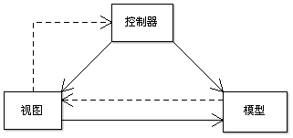

用户操作流程图：

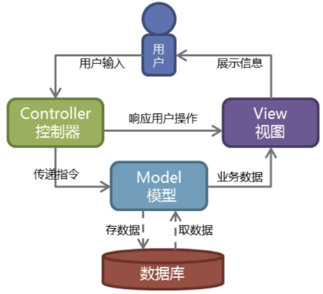

---

#### MTV模型

Django 的 MVT 模式本质上和 MVC 是一样的，也是为了各组件间保持松耦合关系，只是定义上有些许不同，Django 的 MTV 分别是指：

- M 表示模型（Model）：编写程序应有的功能，负责业务对象与数据库的映射(ORM)。
- T 表示模板 (Template)：负责如何把页面(html)展示给用户。
- V 表示视图（View）：负责业务逻辑，并在适当时候调用 Model和 Template。

除了以上三层之外，还需要一个 URL 分发器，它的作用是将一个个 URL 的页面请求分发给不同的 View 处理，View 再调用相应的 Model 和 Template，MTV 的响应模式如下所示：

简易图：

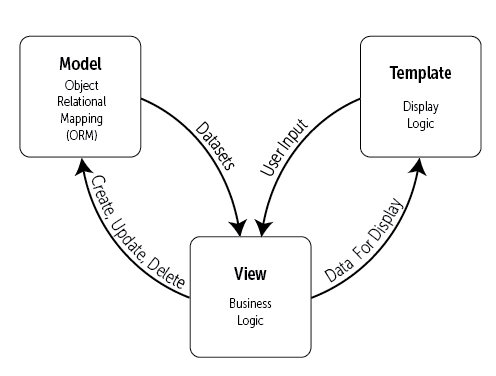

用户操作流程图：

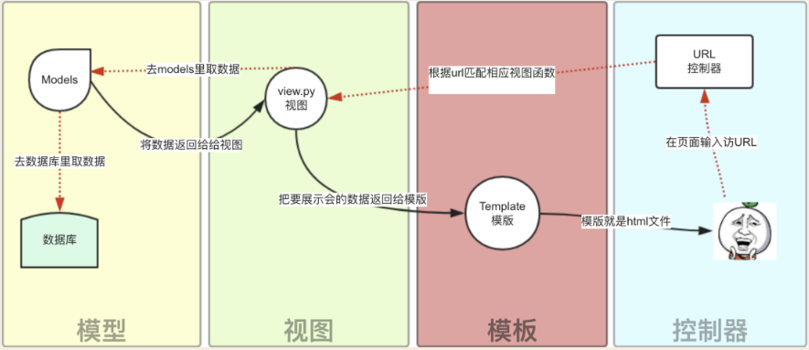

**解析：**

用户通过浏览器向我们的服务器发起一个请求(request)，这个请求会去访问视图函数：

- a.如果不涉及到数据调用，那么这个时候视图函数直接返回一个模板也就是一个网页给用户。
- b.如果涉及到数据调用，那么视图函数调用模型，模型去数据库查找数据，然后逐级返回。

视图函数把返回的数据填充到模板中空格，最后返回网页给用户

## Django版本

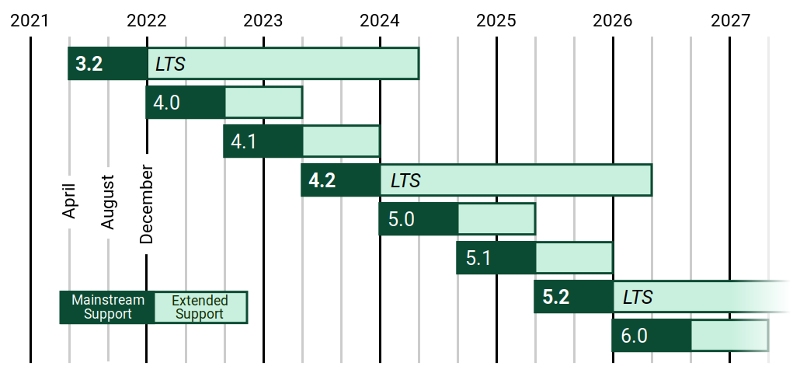

# Django 安装

在安装 Django 前，系统需要已经安装了 Python 的开发环境。如果你还没有安装 Python，请先从 Python 官网 [https://www.python.org/](https://www.python.org/) 下载并安装最新版本的 Python。Django 安装也很简单使包管理工具 pip 就可以了：
先创建一个Python文件,在命令行里输入
```bash 
pip list
```

```bash
pip install Django
```

安装完成后，你可以通过运行以下命令验证 Django 是否成功安装：

```bash
python -m django --version
```

# Django 创建第一个项目

使用 django-admin 来创建 HelloWorld 项目，

```bash
django-admin startproject HelloWorld
```

也可以直接在Pytharm里新建

创建完成后我们可以查看下项目的目录结构：

```text
$ cd HelloWorld/
$ tree
.
|-- HelloWorld
|   |-- __init__.py  不碰
|   |-- asgi.py  部署时才管
|   |-- settings.py  天天改
|   |-- urls.py  经常改
|   -- wsgi.py   部署时才管
|-- manage.py  基本不动
```

目录说明：

- HelloWorld: 项目的容器。
- manage.py: 一个实用的命令行工具，可让你以各种方式与该 Django 项目进行交互-----启动项目 创建项目 数据迁移。
- \_init__.py: 一个空文件，告诉 Python 该目录是一个 Python 包。
- asgi.py: 一个 ASGI 兼容的 Web 服务器的入口，以便运行你的项目。
- settings.py: 该 Django 项目的设置/配置。
- urls.py: 该 Django 项目的 URL 声明; 一份由 Django 驱动的网站"目录"。
- wsgi.py: 一个 WSGI 兼容的 Web 服务器的入口，以便运行你的项目。

## 快速上手

编辑url.py文件

```python
from django.contrib import admin
from django.http import HttpResponse
from django.urls import path

# 编写一个请求处理函数
def login(request):
    return HttpResponse("<h1>Hello World!</h1>")

urlpatterns = [
    path("admin/", admin.site.urls),
    path("login/", login)
]
```

## 启动项目

```bash
python manage.py runserver 0.0.0.0:8080
```

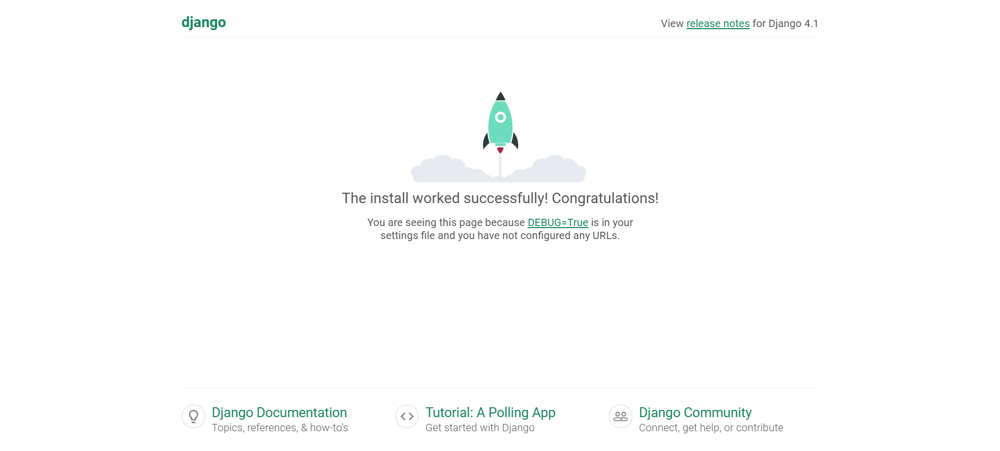

0.0.0.0 让其它电脑可连接到开发服务器，8080 为端口号。如果不说明，那么端口号默认为 8000

在浏览器输入你服务器的 ip（这里我们输入本机 IP 地址： **127.0.0.1:8000**） 及端口号，如果正常启动，输出结果如下：

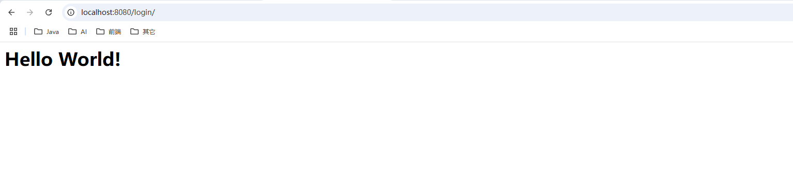

## 项目优化

通过以上操作可以完成Django项目创建和请求处理，但之前项目中请求处理函数和请求映射编写在了同一个文件中，项目的管理不是特别的规范，特别是后续项目比较大的情况下，项目的管理不是特别方便。一般在创建Django项目时，会在Django项目中创建子项目app实现请求函数的编写

**创建app**

**在manage.py同一个层级下，执行以下指令，在该目录下创建app**

```bash
python manage.py startapp web
```

目录介绍

```text
HelloWorld
|-- HelloWorld
|-- manage.py
...
|-- web
|   |-- migrations
|   |-- __init__.py
|   |-- admin.py
|   |-- models.py
|   |-- tests.py
|   |-- views.py
|   |-- apps.py
```

- migrations 数据库迁移文件存放目录，不需要操作，会自动生成
- views.py 视图函数==🟡(业务处理函数)==编写文件 <span style="color:#da3330">经常操作</span>
- models.py 数据库相关操作 类->SQL(ORM) <span style="color:#da3330">经常操作</span>
- apps.py APP的名字 不需要操作
- admin.py 内置的后台管理的配置文件 不需要操作
- tests.py 单元测试 一般不需要操作

修改views.py文件

```python
# 编写一个视图函数
def login(request):
    return HttpResponse("<h1>Hello World!</h1>")
```

修改urls.py文件

```python
from web.views import login

# 请求映射关系
urlpatterns = [
    path("admin/", admin.site.urls),
    path("login/", login)
]
```

启动项目

```bash
python manage.py runserver 0.0.0.0:8080
```

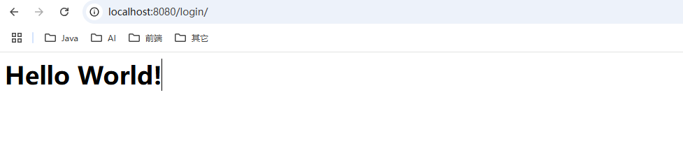

## 路由分层

在一个web项目中可能会有很多的业务单元，如果将所有的url全部维护在项目的urls.py文件中，后期路径的维护将会非常的不方便，所以后续在项目中可以将路由进行分层处理。
          
<span style="color:#00a64e">1.在子项目中创建一个urls.py文件,内容和根项目中保持一致</span>

```python
from django.urls import path
from . import views
urlpatterns = [
    path("hello/", views.hello),
]
```

<span style="color:#00a64e">2.将子项目中的路由，添加到根项目路由文件中</span>

```python
from django.contrib import admin
from django.urls import path, include
import django_app_01.urls as app_01_urls

urlpatterns = [
    path("admin/", admin.site.urls),
    path("app01/", include(app_01_urls)),
]
```

<span style="color:#00a64e">重启项目访问，注意路径需要添加一个前缀 app01</span>

```text
http://localhost:8000/app01/hello
```


## 路由常见写法

```python
# 主路由
urlpatterns = [
    path("admin/", admin.site.urls),
    path('home/', views.home, name='home'),
    # path('news/<str:nid>', views.news, name='news'),
    # path('news/<slug:nid>', views.news, name='news')   #数字 字母 下划线
    # path('news/<path:nid>', views.news, name='news')   #/f1/f2/f3
    path('news/<int:nid>', views.news, name='news'),
]

def news(request, nid):
    return HttpResponse('Hello World News nid = ' + str(nid))
```

## 路由name

路由中配置的name属性表示路由的别名，可以在一定程度上实现解耦合

```python
from django.urls import  reverse
def login(request):
    print('----login---')
    # return redirect('/home')
    return redirect(reverse('home'))

# 反向解析含有参数的路由
redirect(reverse('home',kwargs={nid:1}}))

#页面中的反向解析
<a href=''>跳转</a>
```

## 路由namespace

**辅助name实现路由**

```python
redirect(reverse('namespace:name'))

# 使用了namespace之后 需要设置app_name 属性
```

# Django管理后台

访问后台管理系统  http://localhost:8000/admin

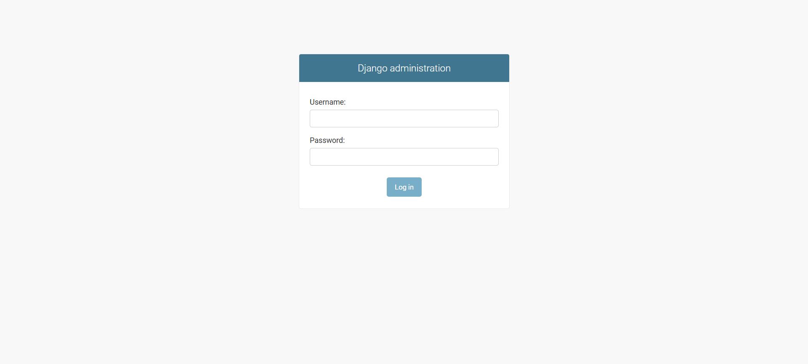

**注册管理员账号**

<span style="color:#f33232">注：要先设置好数据库连接参数，做好了数据迁移，数据库中已经有了项目中默认的表</span>

```bash
python manage.py createsuperuser
```

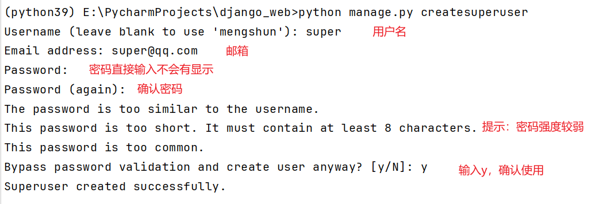

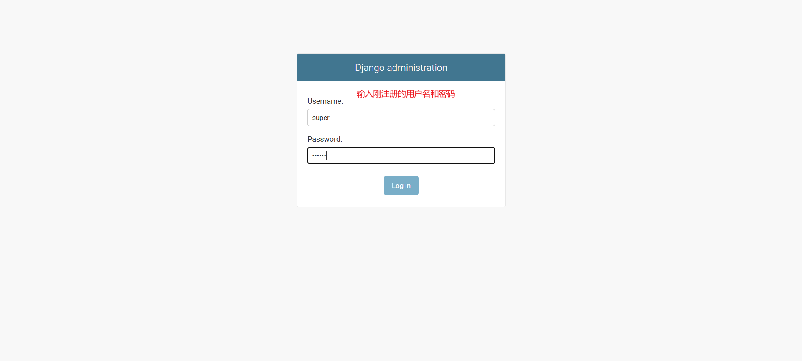

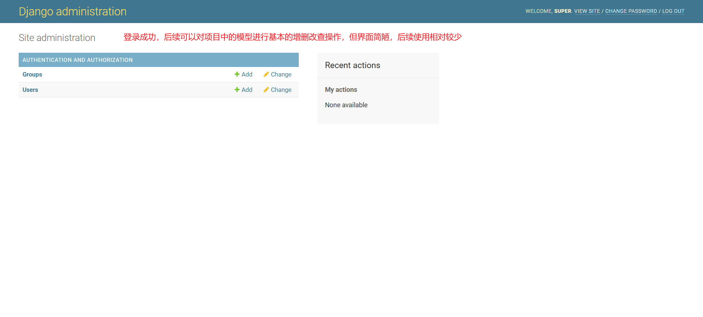

# 初识视图

```python
def login(request):
    # 业务操作
    return HttpResponse("<h1>Hello World!</h1>")
```

- request 请求对象 包含了浏览器发起请求时的相关数据
- 业务操作
- 返回数据 HttpResponse("<h1>Hello World!</h1>") 返回普通文本
- 返回数据 render(request,'login.html') 默认会到根目录下的templates中找login.html模板
- 返回数据 redirect('http://www.baidu.com') 请求重定向

**调整模板默认查找的位置**

**编辑settings.py**

```python
INSTALLED_APPS = [
    "django.contrib.admin",
    "django.contrib.auth",
    "django.contrib.contenttypes",
    "django.contrib.sessions",
    "django.contrib.messages",
    "django.contrib.staticfiles",
    'web.apps.WebConfig',
]
```

<span style="color:#ff0009">**访问优先级**</span>

<span style="color:#ff0009">**如果在项目根路径下和app中的templates目录下有相同的模板，优先访问的是项目根路径下的模板，一般将公共的模板访问项目根路径下，单独的模板写在app中**</span>

# 初识模板

在实际的web项目中，页面中展示的数据往往是通过查询数据库得到的数据，也就是说页面中的数据不是固定不变的，而是可能随着时间地点的不同展示不同的内容，这时候就需要用到Django项目中的模板语法

```python
# 学生信息列表
def student_list(request):
    # 简单数据
    title = '学生信息列表'
    # 数据列表
    students = ['张三', '李四', '王五']
    # 数据字典
    student = {'name': 'lisi', 'age': 20, 'sex': '男'}
    return render(request, 'student_list.html', {'title': title, 'students': students, 'student': student})
```

**模板注释**

```htmldjango
{#单行注释#}


    这里面是多行注释

```

**获取简单数据**

```htmldjango
{{ title }}
```

**获取数据列表**

```htmldjango
#遍历列表

    <li>{{ student }}</li>


# 通过索引
<p>{{ students.0 }}</p>
<p>{{ students.1 }}</p>
<p>{{ students.2 }}</p>
```

**获取字典数据**

```htmldjango
# 通过key获取
<p>{{ student.name }}</p>
<p>{{ student.age }}</p>
<p>{{ student.sex }}</p>

# 遍历字典

    <p>{{ value }}</p>

```

**案例： 使用表格展示用户信息列表**

**视图函数**

```python
def user_list(request):
    users = [
        {
            'name': '张三',
            'age': 20,
            'password': '123456',
            'id': 1
        },
        {
            'name': '李四',
            'age': 25,
            'password': '123456',
            'id': 2
        },
        {
            'name': '王五',
            'age': 12,
            'password': '123456',
            'id': 3
        },
        {
            'name': '赵六',
            'age': 22,
            'password': '123456',
            'id': 4
        }
    ]

    return render(request, 'user_list.html', {'users': users})
```

**模板**

```htmldjango
<table border="1" width="80%" cellspacing="0">
    <tr>
        <th>ID</th>
        <th>姓名</th>
        <th>年龄</th>
        <th>密码</th>
    </tr>
    
        <tr>
            <td>{{ user.id }}</td>
            <td>{{ user.name }}</td>
            <td>{{ user.age }}</td>
            <td>{{ user.password }}</td>
        </tr>
    
</table>
```

**forloop对象，获取循环次数**

在  标签里可以通过 {{forloop}} 变量获取循环序号。

- forloop.counter: 顺序获取循环序号，从 1 开始计算
- forloop.counter0: 顺序获取循环序号，从 0 开始计算
- forloop.revcounter: 倒序获取循环序号，结尾序号为 1
- forloop.revcounter0: 倒序获取循环序号，结尾序号为 0
- forloop.first（一般配合if标签使用）: 第一条数据返回 True，其他数据返回 False
- forloop.last（一般配合if标签使用）: 最后一条数据返回 True，其他数据返回 False

**过滤器**

模板语法：

```htmldjango
{{ 变量名 | 过滤器：可选参数 }}
```

模板过滤器可以在变量被显示前修改它，过滤器使用管道字符，如下所示：

```htmldjango
{{ name|lower }}
```

{{ name }} 变量被过滤器 lower 处理后，文档大写转换文本为小写。

过滤管道可以被* 套接* ，既是说，一个过滤器管道的输出又可以作为下一个管道的输入：

```htmldjango
{{ my_list|first|upper }}
```

以上实例将第一个元素并将其转化为大写。

有些过滤器有参数。 过滤器的参数跟随冒号之后并且总是以双引号包含。 例如：

```htmldjango
{{ bio|truncatewords:"30" }}
```

这个将显示变量 bio 的前30个词。

其他过滤器：

- addslashes : 添加反斜杠到任何反斜杠、单引号或者双引号前面。
- date : 按指定的格式字符串参数格式化 date 或者 datetime 对象，实例：

  ```htmldjango
  {{ pub_date|date:"F j, Y" }}
  ```

- length : 返回变量的长度。

**default**

default 为变量提供一个默认值。

如果 views 传的变量的布尔值是 false，则使用指定的默认值。

以下值为 false：

```python
0  0.0  False  0j  ""  []  ()  set()  {}  None
```

**length**

返回对象的长度，适用于字符串和列表。

字典返回的是键值对的数量，集合返回的是去重后的长度。

**date**

根据给定格式对一个日期变量进行格式化。

格式 `Y-m-d H:i:s`返回 **年-月-日 小时:分钟:秒** 的格式时间。

```htmldjango
{{ time|date:"Y-m-d" }}
```

## 模板继承

多个页面有相同的头部信息

```htmldjango
<nav class="navbar navbar-default">
    <div class="container">
        <div class="navbar-header">
            <span class="navbar-brand">OA</span>
        </div>
        <div class="collapse navbar-collapse" id="bs-example-navbar-collapse-1">
            <ul class="nav navbar-nav">
                <li><a href="/app02/dept/list/">部门管理</a></li>
                <li><a href="#">用户管理</a></li>
            </ul>
            <ul class="nav navbar-nav navbar-right">
                <li><a href="#">登录</a></li>
                <li class="dropdown">
                    <a href="#" class="dropdown-toggle" data-toggle="dropdown" role="button" aria-haspopup="true"
                       aria-expanded="false">Admin <span class="caret"></span></a>
                    <ul class="dropdown-menu">
                        <li><a href="#">个人中心</a></li>
                        <li><a href="#">修改密码</a></li>
                        <li role="separator" class="divider"></li>
                        <li><a href="#">安全退出</a></li>
                    </ul>
                </li>
            </ul>
        </div>
    </div>
</nav>
<div>
    <div class="container">
        <div style="margin-bottom: 15px">
            <a class="btn btn-success btn-sm" href="/app02/dept/add">
                <span class="glyphicon glyphicon-plus" aria-hidden="true"></span>
                新增</a>
        </div>
        <div class="panel panel-default">
            <div class="panel-heading">
                <span class="glyphicon glyphicon-th-list" aria-hidden="true"></span>
                部门列表
            </div>
            <table class="table table-bordered table-hover">
                <thead>
                <tr>
                    <th>ID</th>
                    <th>部门名称</th>
                    <th>部门地址</th>
                    <th>创建时间</th>
                    <th>操作</th>
                </tr>
                </thead>
                <tbody>
                
                    
                        <tr>
                            <td>{{ dept.id }}</td>
                            <td>{{ dept.title }}</td>
                            <td>{{ dept.location }}</td>
                            <td>{{ dept.create_time|date:'Y-m-d' }}</td>
                            <td>
                                <a class="btn btn-primary btn-xs" href="/app02/dept/edit/?id={{ dept.id }}">编辑</a>
                                <a class="btn btn-danger btn-xs" href="/app02/dept/remove/{{ dept.id }}">删除</a>
                            </td>
                         </tr>
                    
                 
                    <tr>
                        <td colspan="5" style="text-align: center">数据为空,请添加数据</td>
                    </tr>
                

                </tbody>

            </table>
        </div>
    </div>
</div>
```

<span style="color:#00a64e">**将代码拆分为两个文件，实现继承**</span>

<span style="color:#00a64e">**主模版**</span>

```htmldjango

<!DOCTYPE html>
<html lang="en">
<head>
    <meta charset="UTF-8">
    <title>主页</title>
    <link rel="stylesheet" href=""></link>
    <script type="text/javascript" src=""></script>
    <script type="text/javascript" src=""></script>
</head>
<body>
<nav class="navbar navbar-default">
    <div class="container">
        <div class="navbar-header">
            <span class="navbar-brand">OA</span>
        </div>
        <div class="collapse navbar-collapse" id="bs-example-navbar-collapse-1">
            <ul class="nav navbar-nav">
                <li><a href="/app02/dept/list/">部门管理</a></li>
                <li><a href="#">用户管理</a></li>
            </ul>
            <ul class="nav navbar-nav navbar-right">
                <li><a href="#">登录</a></li>
                <li class="dropdown">
                    <a href="#" class="dropdown-toggle" data-toggle="dropdown" role="button" aria-haspopup="true"
                       aria-expanded="false">Admin <span class="caret"></span></a>
                    <ul class="dropdown-menu">
                        <li><a href="#">个人中心</a></li>
                        <li><a href="#">修改密码</a></li>
                        <li role="separator" class="divider"></li>
                        <li><a href="#">安全退出</a></li>
                    </ul>
                </li>
            </ul>
        </div>
    </div>
</nav>
<div>
    
</div>
</body>
</html>
```

<span style="color:#00a64e">**子模版**</span>

```htmldjango



    <div class="container">
    <div class="panel panel-success">
        <div class="panel-heading">新增部门</div>
        <div class="panel-body">
             <form method="post" action="/app02/dept/add/">
            <div class="form-group">
                <label for="title">部门名称</label>
                <input type="text" class="form-control" id="title" name="title" placeholder="请输入部门名称">
            </div>
            <div class="form-group">
                <label for="location">部门地址</label>
                <input type="text" class="form-control" id="location"  name="location"  placeholder="请输入部门地址">
            </div>
            <button type="submit" class="btn btn-success btn-sm">新增</button>
        </form>
        </div>
    </div>
</div>

```

<span style="color:#00a64e">**静态资源处理**</span>

以上通过模板可以动态的渲染数据库的数据在页面中，但页面的UI效果不是特别的友好，在Django的web项目中可以引入一些静态资源，对模板渲染效果进行一些优化

在创建的web app的根路径下创建一个static的目录，并将项目中需要使用的静态资源放在该目录中，为了简化样式的设置，可以引入一些第三方的开源UI组件库，这里我们使用LayUI作为静态资源

## 下载引用

您可以通过以下任意一种方式获得 Layui ，您可以在 [官网首页](https://layui.dev/)下载到 Layui，它经过了自动化构建，更适合用于生产环境。目录结构如下：

```text
layui/
  ├─css
  │  └─layui.css   # 核心样式库
  └─layui.js       # 核心模块库
```

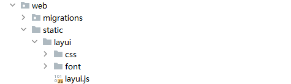

引入css资源，优化用户信息列表页面效果

```htmldjango
<!DOCTYPE html>
<html lang="en">
<head>
    <meta charset="UTF-8">
    <title>用户信息列表</title>
    <link rel="stylesheet" href="/static/layui/css/layui.css">
</head>
<body>

<table class="layui-table">
    <tr>
        <th>ID</th>
        <th>姓名</th>
        <th>年龄</th>
        <th>密码</th>
    </tr>
    
        <tr>
            <td>{{ user.id }}</td>
            <td>{{ user.name }}</td>
            <td>{{ user.age }}</td>
            <td>{{ user.password }}</td>
        </tr>
    

</table>

</body>
</html>
```

## 重启项目，展示效果

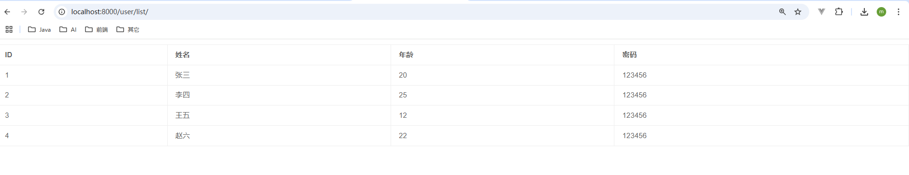

动态引入静态资源

```htmldjango

<!DOCTYPE html>
<html lang="en">
<head>
    <meta charset="UTF-8">
    <title>用户信息列表</title>
    <link rel="stylesheet" href="">
</head>
```

# Request对象

```python
'''
http请求：http://127.0.0.1:8000/request?name=admin&age=20
请求协议 域名  资源地址  【参数】
'''
def method1(request):
    # 获取请求方式
    print(f'请求方式:', request.method)
    # 获取请求路径
    print(f'请求路径是:', request.path)
    # 没有参数传递会抛出异常
    print(f'请求参数:', request.GET['name'])
    # 没有参数传递 返回None
    print(f'请求参数:', request.GET.get('age'))
    # 没有参数传递 设置默认值
    print(request.GET.get('age',50))
    # 获取多个值
    print(f'请求参数:', request.GET.getlist('lvs'))
    return HttpResponse('<h1>ok</h1>')
```

<span style="color:#00a64e">请求方式是POST，参数接收</span>

```python
def hello2(request):
    # 只能接收post请求体参数
    print(request.POST,type(request.POST))
    print(request.POST.get('name'))
    print(request.POST.get('age'))
    print(request.POST.getlist('lv'),type(request.POST.getlist('lv')))
    # 一般通过json格式进行数据传输
    print(json.loads(request.body),type(json.loads(request.body)))
    return HttpResponse("<h1>Hello World2!</h1>", content_type="text/html")
```

<span style="color:#00a64e">**请求头参数**</span>

```python
#  获取请求头参数
def hello3(request):
    '''获取请求头数据'''
    # print(request.META)  #原生请求头
    print(request.headers)  # http请求头
    return HttpResponse("<h1>Hello World3!</h1>", content_type="text/html")
```

<span style="color:#00a64e">**上传文件**</span>

```python
#  获取上传文件
def hello4(request):
    '''获取文件 可以接收多个文件'''
    print(request.FILES)
    f_user = request.FILES['file']
    with open(f'{os.path.dirname(__file__)}/{f_user.name}', 'wb') as f:
        f.write(f_user.read())
    return HttpResponse("<h1>Hello World3!</h1>", content_type="text/html")
```

# Response对象

## 响应数据

**html  一般用于前后端不分离情况**

```python
def hello5(request):
    """响应html数据"""
    return HttpResponse("<h1>Hello World5!</h1>", content_type="text/html")
```

**json  一般用于前后端分离情况**

```python
def hello6(request):
    """响应json格式数据"""
    data = {
        "age": 50,
        "name":"tom",
        "sex":"男"
    }
    data_json = json.dumps(data)
    return HttpResponse(data_json, content_type="application/json")
from django.http.response import JsonResponse
def hello6(request):
    """响应json格式数据"""
    data = {
        "age": 50,
        "name":"tom",
        "sex":"男"
    }
    data_list = [data,data,data]
    # JsonResponse不直接支持列表数据转换为json格式，需要开启非安全模式
    return  JsonResponse(data_list,safe=False)
```

**文件下载**

```python
# 返回图片文件
def hello7(request):
    with open(f'{os.path.dirname(__file__)}/1.png', 'rb') as f:
        data = f.read()
        print(data)
    return HttpResponse(content=data, content_type='image/png')
```

**常见的MIME类型**

### 1. 文本类型（Text）

- text/plain：纯文本文件
- text/html：HTML文档
- text/css：CSS样式表文件
- text/csv：CSV文件

### 2. 图像类型（Image）

- image/jpeg：JPEG图像文件
- image/png：PNG图像文件
- image/gif：GIF图像文件
- image/bmp：BMP图像文件
- image/svg+xml：SVG图像文件
- image/webp：WebP图像文件

### 3. 音频类型（Audio）

- audio/mpeg：MP3音频文件
- audio/wav：WAV音频文件
- audio/ogg：OGG音频文件
- audio/flac：FLAC音频文件
- audio/aac：AAC音频文件

### 4. 视频类型（Video）

- video/mp4：MP4视频文件
- video/webm：WebM视频文件（
- video/ogg：OGG视频文件
- video/quicktime：QuickTime视频文件
- video/mpeg：MPEG视频文件

### 5. 应用类型（Application）

- application/json：JSON文件（
- application/pdf：PDF文件
- application/zip：ZIP压缩文件
- application/rar：RAR压缩文件
- application/xml：XML文件（
- application/javascript JavaScript文件
- application/octet-stream二进制流文件（用于通用二进制文件）。

### 6. 字体类型（Font）

- font/woff：WOFF字体文件（如

  .woff）。

- font/woff2：WOFF2字体文件（如

  .woff2）。

- font/ttf：TTF字体文件（如

  .ttf）。

- font/otf：OTF字体文件（如

  .otf）。

- font/svg：SVG字体文件（如

.svg）。

## 页面跳转

转发： 页面地址不变，可以共用request请求

```python
def hello10(request):
    return render(request,'hello.html')
```

重定向： 页面地址改变 ，不能共用request请求

```python
# 页面跳转
def hello8(request):
    return HttpResponseRedirect('http://www.baidu.com/')

def hello9(request):
    return redirect('http://www.baidu.com/')
```

# Django 模型

Django 对各种数据库提供了很好的支持，包括：PostgreSQL、MySQL、SQLite、Oracle。Django 为这些数据库提供了统一的调用API。 我们可以根据自己业务需求选择不同的数据库。MySQL 是 Web 应用中最常用的数据库。如果你没安装 mysql 驱动，可以执行以下命令安装：

```bash
sudo pip3 install pymysql
```

## Django ORM

- Django 模型使用自带的 ORM。
- 对象关系映射（Object Relational Mapping，简称 ORM ）用于实现面向对象编程语言里不同类型系统的数据之间的转换。
- ORM 在业务逻辑层和数据库层之间充当了桥梁的作用。
- ORM 是通过使用描述对象和数据库之间的映射的元数据，将程序中的对象自动持久化到数据库中

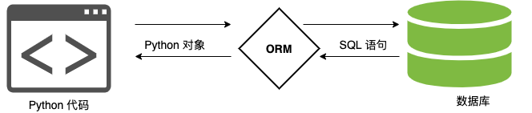

**使用 ORM 的好处：**

- 提高开发效率。
- 不同数据库可以平滑切换。

**使用 ORM 的缺点：**

- ORM 代码转换为 SQL 语句时，需要花费一定的时间，执行效率会有所降低。
- 长期写 ORM 代码，会降低编写 SQL 语句的能力。

**ORM 解析过程:**

- 1、ORM 会将 Python 代码转成为 SQL 语句。
- 2、SQL 语句通过 pymysql 传送到数据库服务端。
- 3、在数据库中执行 SQL 语句并将结果返回。

**ORM 对应关系表：**

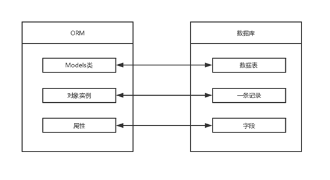

# 数据动态渲染

**数据库中的表**

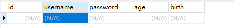

### 创建表

编辑app01_login项目中的models.py文件，创建类

```python
# 默认会自动添加一个自增的主键字段id  类必须继承models.Model
class User_Info(models.Model):
    username = models.CharField(max_length=50, verbose_name='用户名')  # varchar
    password = models.CharField(max_length=20, verbose_name='密码')  # varchar
    age = models.IntegerField(verbose_name='年龄')  # int
    birth = models.DateField(verbose_name='生日')
```

<span style="color:#da3330">表名组成结构为：应用名_类名（如：TestModel_user_info）</span>

<span style="color:#da3330">**注意：**尽管我们没有在 models 给表设置主键，但是 Django 会自动添加一个 id 作为主键</span>。

### 数据库配置

创建 MySQL 数据库( ORM 无法操作到数据库级别，只能操作到数据表)语法：

```sql
create database 数据库名称 default charset=utf8; # 防止编码问题，指定为 utf8
```

编辑settings.py文件

```python
#  设置mysql连接参数
DATABASES = {
    "default": {
        "ENGINE": "django.db.backends.mysql", # 数据库类型声明
        "NAME": "django",   #数据库名
        "USER": 'root',    # 用户名
        "PASSWORD": 'root', # 密码
        "HOST": '127.0.0.1',  # 数据库服务器地址
        "PORT": '3306'  # 数据库服务器端口
    }
}
```

<span style="color:#00a64e">配置连接池</span>

<span style="color:#00a64e">安装连接池</span>

```python
pip install django-db-connection-pool
"POOL_OPTIONS": {
    "pool_size": 10,  # 最小
    "max_overflow": 10,  # 最大在原来基础上增加10个 也就是 20个
    "timeout": 30,  # 等待时间
}
```

### 安装mysqlclient

django内部默认使用mysqlclient连接数据库

```bash
pip install mysqlclient
```

<span style="color:#00a64e">使用pymysql</span>

```bash
pip install pymysql
```

<span style="color:#00a64e">在项目根目录下_init_.py配置pymysql</span>

```python
import pymysql
#  默认使用MySQLdb  设置使用pymysql替代MySQLdb
pymysql.install_as_MySQLdb()
```

### 创建和管理数据库迁移

**创建迁移文件**：对于每个Django模型，你需要创建一个迁移文件。这可以通过运行以下命令完成：

```bash
python manage.py makemigrations
```

**应用迁移**：迁移文件创建后，你需要将它们应用到数据库中

```bash
python manage.py migrate
```

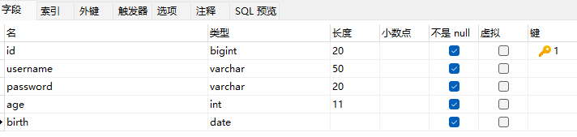

### 单表ORM

#### 新增

通过 ORM 提供的 objects 提供的方法 create 来实现（推荐）

```python
models.User.objects.create(username='user2', password='123456', age=20, address='安徽合肥',
                           birthday='2024-12-08')
```

#### 查询

使用 **all()** 方法来查询所有内容。

返回的是 QuerySet 类型数据，类似于 list，里面放的是一个个模型类的对象，可用索引下标取出模型类的对象

```python
users = models.User.objects.all()
```

**filter()** 方法用于查询符合条件的数据。

返回的是 QuerySet 类型数据，类似于 list，里面放的是满足条件的模型类的对象，可用索引下标取出模型类的对象。pk=3 的意思是主键 primary key=3，相当于 id=3。

因为 id 在 pycharm 里有特殊含义，是看内存地址的内置函数 id()，因此用 pk

```python
users = models.User.objects.filter(pk=pk)
```

**exclude()** 方法用于查询不符合条件的数据。

返回的是 QuerySet 类型数据，类似于 list，里面放的是不满足条件的模型类的对象，可用索引下标取出模型类的对象

```python
users = models.User.objects.exclude(pk=pk)
```

**get()** 方法用于查询符合条件的返回模型类的对象符合条件的对象只能为一个，<span style="color:#f33232">如果符合筛选条件的对象超过了一个或者一个没有都会抛出错误</span>

```python
user = models.User.objects.get(id=1)
```

**order_by()** 方法用于对查询结果进行排序。

返回的是 QuerySet类型数据，类似于list，里面放的是排序后的模型类的对象，可用索引下标取出模型类的对象。

**注意：**

- a、参数的字段名要加引号。
- b、降序为在字段前面加个负号 `-`

```python
# 查询所有，按照id升序排列
users = models.User.objects.order_by('id')
# 查询所有，按照id降序排列
users = models.User.objects.order_by('-id')
```

**reverse()** 方法用于对查询结果进行反转。

返回的是 QuerySe t类型数据，类似于 list，里面放的是反转后的模型类的对象，可用索引下标取出模型类的对象

```python
# 按照id降序排列：降序再反转
users = models.User.objects.all().order_by('-id').reverse()
```

**count()** 方法用于查询数据的数量返回的数据是整数

```python
count = models.User.objects.count()
```

**first()** 方法返回第一条数据返回的数据是模型类的对象也可以用索引下标 `[0]`

```python
user = models.User.objects.all().first()
```

**last()** 方法返回最后一条数据返回的数据是模型类的<span style="color:#f33232">对象不能用索引下标</span> `[-1]`，<span style="color:#f33232">ORM 没有逆序索引</span>。

```python
user = models.User.objects.all().last()
```

**exists()** 方法用于判断查询的结果 QuerySet 列表里是否有数据。

返回的数据类型是布尔，有为 true，没有为 false。

<span style="color:#f33232">**注意：**判断的数据类型只能为 QuerySet 类型数据，不能为整型和模型类的对象</span>

```python
exist = models.User.objects.all().exists()
# 抛出异常信息 判断的数据类型只能为 QuerySet 类型数据，不能为整型和模型类的对象
exist = models.User.objects.all().first().exists()
```

**values()** 方法用于查询部分字段的数据。

返回的是 QuerySet 类型数据，类似于 list，里面不是模型类的对象，而是一个可迭代的字典序列，字典里的键是字段，值是数据。

**注意：**

- 参数的字段名要加引号
- 想要字段名和数据用 `values`

```python
users = models.User.objects.all().values('username', 'password', 'address')
for user in users:
    for key in user.keys():
        print(key, "=", user[key])
```

**values_list()** 方法用于查询部分字段的数据。

返回的是 QuerySet 类型数据，类似于 list，里面不是模型类的对象，而是一个个元组，元组里放的是查询字段对应的数据。

**注意：**

- 参数的字段名要加引号
- 只想要数据用 values_list

```python
users = models.User.objects.all().values_list('username')
```

**distinct()** 方法用于对数据进行去重。

返回的是 QuerySet 类型数据。

**注意：**

- 对模型类的对象去重没有意义，因为每个对象都是一个不一样的存在。
- distinct() 一般是联合 values 或者 values_list 使用

```python
users = models.User.objects.all().values_list('password').distinct()
```

**filter()** 方法基于双下划线的模糊查询（exclude 同理）。

**注意：**filter 中运算符号只能使用等于号 = ，不能使用大于号 > ，小于号 < ，等等其他符号。

__in 用于读取区间，= 号后面为列表

```python
users = models.User.objects.all().filter(age__in=[10, 15, 20])
```

**__gt** 大于号 ，= 号后面为数字

```python
users = models.User.objects.all().filter(age__gt=20)
```

**__gte** 大于等于，= 号后面为数字

```python
users = models.User.objects.all().filter(age__gte=20)
```

**__lt** 小于，=号后面为数字

```python
users = models.User.objects.all().filter(age__lt=20)
```

**__lte** 小于等于，= 号后面为数字

```python
users = models.User.objects.all().filter(age__lte=20)
```

**__range** 在 ... 之间，左闭右闭区间，= 号后面为两个元素的列表

```python
users = models.User.objects.all().filter(age__range=[10, 20])
```

**__contains** 包含，= 号后面为字符串

```python
users = models.User.objects.all().filter(username__contains='u')
```

**__icontains** 不区分大小写的包含，= 号后面为字符串

```python
users = models.User.objects.all().filter(username__icontains ='u')
```

**__startswith** 以指定字符开头，= 号后面为字符串

```python
users = models.User.objects.all().filter(username__startswith='u')
```

**__endswith** 以指定字符结尾，= 号后面为字符串

```python
users = models.User.objects.all().filter(username__endswith='n')
```

**__year** 是 DateField 数据类型的年份，= 号后面为数字

```python
users = models.User.objects.all().filter(birthday__year='2024')
```

**__month** 是DateField 数据类型的月份，= 号后面为数字

```python
users = models.User.objects.all().filter(birthday__month='12')
```

**__day** 是DateField 数据类型的天数，= 号后面为数字

```python
users = models.User.objects.all().filter(birthday__day='10')
```

#### 删除

使用 QuerySet `类型数据.delete()`(推荐)

**返回值：**元组，第一个元素为受影响的行数。

```python
models.User.objects.filter(pk=pk).delete()
```

**注意：**

- Django 删除数据时，会模仿 SQL约束 ON DELETE CASCADE 的行为，也就是删除一个对象时也会删除与它相关联的外键对象。
- delete() 方法是 QuerySet 数据类型的方法，但并不适用于 Manager 本身。也就是想要删除所有数据，不能不写 all

#### 修改

QuerySet 类型数据.update(字段名=更改的数据)（推荐）

**返回值：**整数，受影响的行数

```python
models.User.objects.filter(pk=pk).update(username=username,password=password, age=age, address=address, birthday=birthday)
```

### 代码参考

```python
#  添加学生信息
def mysql_add(request):
    """
       添加学生信息方式1
         try:
            student = Student(stu_no="202603002", name="student1", age=20, score=90)
            # 调用数据保存api  save
            student.save()
         except IntegrityError as e:
            return HttpResponse('学号重复,请检查', content_type='text/html;charset=utf-8')
    """

    """
       添加学生信息方式2
    """
    Student.objects.create(stu_no="202603004", name="student4", age=23, score=81)
    return HttpResponse('mysql method ok', content_type='text/html;charset=utf-8')

#  修改学生信息
def mysql_update(request):
    """
        修改学生信息方式1   id=4    pk  主键 primary_key
        update student set stu_name = 'student2' where id = 4
        Student.objects.filter(pk=4).update(name='student2')   #  update_time 不会更新
    """

    """
         修改学生信息方式2   id=4
     """
    # 根据id 查询需要修改的学生信息   .first()  获取查询结果的第一条数据
    student = Student.objects.filter(pk=4).first()
    #  设置需要修改的数据
    student.name = 'Student2'
    # 保存数据    update_time 会更新    save()  数据id不为空 则执行更新  为空则执行新增
    student.save()

    return HttpResponse('mysql update method ok', content_type='text/html;charset=utf-8')

#  删除一条数据
def mysql_del(request):
    #  根据id删除数据  delete from student where id = 4
    Student.objects.filter(pk=4).delete()
    return HttpResponse('mysql delete method ok', content_type='text/html;charset=utf-8')

#  根据id查询一条数据
def mysql_query_one(request):
    #  id = 1
    """
    #  Student  object
    student = Student.objects.filter(pk=1).first()
    print(student,type(student))
    print(student.id,student.name,student.age,student.score)
    """

    """
     #  dict  values('字段名'.....)
    student = Student.objects.filter(pk=1).values('id','name','age').first()
    print(student,type(student))
    print(student.get('id'),student.get('name'),student.get('age'),student.get('score'))

    """
    # tuple
    student = Student.objects.filter(pk=1).values_list('id', 'name', 'age').first()
    print(student, type(student))
    print(student[0], student[1])
    return HttpResponse('mysql query method ok', content_type='text/html;charset=utf-8')

#  数据列表
def mysql_query_list(request):
    # Student  object   [Student,Student,Student...]  order_by 排序 默认升序  -id 倒序
    # values [{},{},{}]  values_list()   [(),(),()]
    students = list(Student.objects.all().values().order_by('-id'))
    return render(request, 'dataTemplate.html', {'students': students})

def mysql_query_count(request):
    #  统计查询数据的总条数
    # student_numbers = Student.objects.all().count()
    # 数据去重
    # students = Student.objects.all().values('age').distinct()
    #  获取结果集中的最后一条数据  第一条数据
    # student = Student.objects.all().first()
    # student = Student.objects.all().last()
    # 判定查询结果是否为空
    is_exist = Student.objects.all().exists()
    print(is_exist)
    return HttpResponse(f'is_exist {is_exist}')

def mysql_query_filter(request):
    # filter  stu_no 202603007  age 23   where stu_no = '202603007' and age = 23     None
    # student = Student.objects.filter(stu_no='202603007',age=22).values('id','stu_no','name','age').first()
    """
       age > 20  age >=20  age < 20
       age__gt   age >
       age__gte   age >=
       age__lt   age <
       age__lte   age <=

       202603001  202603002  202603003  202603004
       where stu_no = '202603004' or stu_no = '202603003' or stu_no = '202603001'
       age__in = (202603001, 202603002, 202603003, 202603004)
        where stu_no in ('202603001', '202603002', '202603003')

        区间
        age__range   where age  between 10 and 20     where   age >= 10 and age < 20

        多条件查询     and   or
         age    10   20
         score  70  80

         Q()

    """
    # q1 = Q(age__range=(10, 20), stu_no='202603001')
    # q2 = Q(score__range=(70, 80))
    #
    # # students = Student.objects.all().filter(q1 & q2).values('stu_no', 'name', 'age','score')
    # students = Student.objects.all().filter(q1 | q2).values('stu_no', 'name', 'age', 'score')

    #  模糊查询  a%   %1  %1%
    # students = Student.objects.all().filter(name__startswith='a').values('stu_no', 'name', 'age', 'score')
    # students = Student.objects.all().filter(name__endswith='1').values('stu_no', 'name', 'age', 'score')
    students = Student.objects.all().filter(name__contains='1').values('stu_no', 'name', 'age', 'score')

    for student in students:
        print(student.get('stu_no'), student.get('name'), student.get('age'), student.get('score'))
    return HttpResponse(f'mysql_query_filter ok')
```

### 关联ORM

表与表之间的关系可分为以下三种：

- 一对一: 一个人对应一个身份证号码，数据字段设置 unique
- 一对多: 一个家庭有多个人，一般通过外键来实现
- 多对多: 一个学生有多门课程，一个课程有很多学生，一般通过第三个表来实现关联

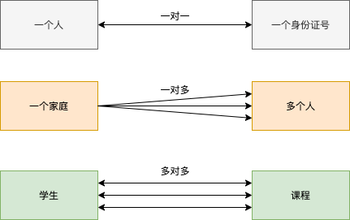

**创建模型**

```python
# 书籍
class Book(models.Model):
    title = models.CharField(verbose_name='书籍名称', max_length=32)
    price = models.DecimalField(verbose_name='价格', max_digits=5, decimal_places=2)
    pub_date = models.DateField(verbose_name='出版日期')
    # 外键
    publish = models.ForeignKey("Publish", on_delete=models.CASCADE)
    authors = models.ManyToManyField("Author")

# 出版社
class Publish(models.Model):
    name = models.CharField(max_length=32, verbose_name='出版社名字')
    city = models.CharField(max_length=64, verbose_name='出版社城市')
    email = models.EmailField(verbose_name='出版社邮箱')

# 作者
class Author(models.Model):
    name = models.CharField(max_length=32, verbose_name='作者')
    age = models.SmallIntegerField(verbose_name='年龄')
    au_detail = models.OneToOneField("AuthorDetail", on_delete=models.CASCADE)

# 作者详情
class AuthorDetail(models.Model):
    gender_choices = (
        (0, "女"),
        (1, "男"),
        (2, "保密"),
    )
    gender = models.SmallIntegerField(choices=gender_choices)
    tel = models.CharField(max_length=32)
    addr = models.CharField(max_length=64)
    birthday = models.DateField()
```

**说明：**

- 1、EmailField 数据类型是邮箱格式，底层继承 CharField，进行了封装，相当于 MySQL 中的 varchar。
- 2、Django1.1 版本不需要联级删除：on_delete=models.CASCADE，Django2.2 需要。
- 3、一般不需要设置联级更新.
- 4、外键在一对多的多中设置：`models.ForeignKey("关联类名", on_delete=models.CASCADE)`。
- 5、OneToOneField = ForeignKey(...，unique=True)设置一对一。
- 6、<span style="color:#f33232">若有模型类存在外键，创建数据时，要先创建外键关联的模型类的数据，不然创建包含外键的模型类的数据时，外键的关联模型类的数据会找不到。</span>

**表结构**

**书籍表 Book**：title 、 price 、 pub_date 、 publish（外键，多对一） 、 authors（多对多）

**出版社表 Publish**：name 、 city 、 email

**作者表 Author**：name 、 age 、 au_detail（一对一）

**作者详情表 AuthorDetail**：gender 、 tel 、 addr 、 birthday

以下是表格关联说明：

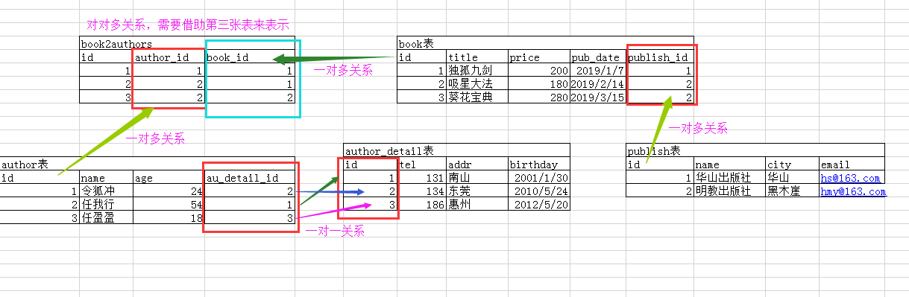

**插入数据**

在 MySQL 中执行以下 SQL 插入操作

```sql
insert into app01_publish(name,city,email) values ("华山出版社", "华山", "hs@163.com"), ("明教出版社", "黑木崖", "mj@163.com")

# 先插入 authordetail 表中多数据
insert into app01_authordetail(gender,tel,addr,birthday) values (1,13432335433,"华山","1994-5-23"), (1,13943454554,"黑木崖","1961-8-13"), (0,13878934322,"黑木崖","1996-5-20")

# 再将数据插入 author，这样 author 才能找到 authordetail
insert into app01_author(name,age,au_detail_id) values ("令狐冲",25,1), ("任我行",58,2), ("任盈盈",23,3)
```

#### 新增

**一对多(外键 ForeignKey)**

**方式一:** 传对象的形式，返回值的数据类型是对象，书籍对象

**步骤：**

- a. 获取出版社对象
- b. 给书籍的出版社属性 pulish 传出版社对象

```python
def add_book(request):
    #  获取出版社对象
    pub_obj = models.Publish.objects.filter(pk=1).first()
    #  给书籍的出版社属性publish传出版社对象
    book = models.Book.objects.create(title="Python从入门到精通", price=200, pub_date="2010-10-10", publish=pub_obj)
    print(book, type(book))
    return HttpResponse(book)
```

**方式二:** 传对象 id 的形式(由于传过来的数据一般是 id,所以传对象 id 是常用的)。

一对多中，设置外键属性的类(多的表)中，MySQL 中显示的字段名是:**外键属性名_id**。

返回值的数据类型是对象，书籍对象。

**步骤：**

- 获取出版社对象的 id
- 给书籍的关联出版社字段 pulish_id 传出版社对象的 id

```python
def add_book(request):
    #  获取出版社对象
    pub_obj = models.Publish.objects.filter(pk=1).first()
    #  获取出版社对象的id
    pk = pub_obj.pk
    #  给书籍的关联出版社字段 publish_id 传出版社对象的id
    book = models.Book.objects.create(title="冲灵剑法", price=100, pub_date="2004-04-04", publish_id=pk)
    print(book, type(book))
    return HttpResponse(book)
```

# Cookie&Session

以上实现了项目的登录认证和数据的动态操作，但项目中存在一个问题，用户可以绕开认证操作直接访问主页面，因此之前写的认证操作就形同虚设，能否在用户访问后台接口时，识别用户是否是合法用户呢，不是合法用户则直接跳转页面到登录页，从而解决认证不生效的问题。

**如何区别用户身份？**

**cookie&session会话机制**

Cookie 是存储在客户端计算机上的文本文件，并保留了各种跟踪信息。

识别返回用户包括三个步骤：

- 服务器脚本向浏览器发送一组 Cookie。例如：姓名、年龄或识别号码等。
- 浏览器将这些信息存储在本地计算机上，以备将来使用。
- 当下一次浏览器向 Web 服务器发送任何请求时，浏览器会把这些 Cookie 信息发送到服务器，服务器将使用这些信息来识别用户。

HTTP 是一种"无状态"协议，这意味着每次客户端检索网页时，客户端打开一个单独的连接到 Web 服务器，服务器会自动不保留之前客户端请求的任何记录。

但是仍然有以下方式来维持 Web 客户端和 Web 服务器之间的 session 会话：

### Cookies

一个 Web 服务器可以分配一个唯一的 session 会话 ID 作为每个 Web 客户端的 cookie，对于客户端的后续请求可以使用接收到的 cookie 来识别。

在Web开发中，使用 session 来完成会话跟踪，session 底层依赖 Cookie 技术。

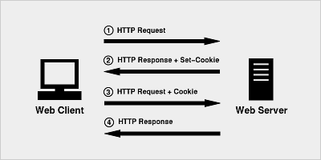

### Cookie 的语法

**设置 cookie:**

```python
rep.set_cookie(key,value,...)
```

**获取 cookie:**

```python
request.COOKIES.get(key)
```

**删除 cookie:**

```python
rep = HttpResponse || render || redirect
rep.delete_cookie(key)
```

### Session(保存在服务端的键值对)

服务器在运行时可以为每一个用户的浏览器创建一个其独享的 session 对象，由于 session 为用户浏览器独享，所以用户在访问服务器的 web 资源时，可以把各自的数据放在各自的 session 中，当用户再去访问该服务器中的其它 web 资源时，其它 web 资源再从用户各自的 session 中取出数据为用户服务

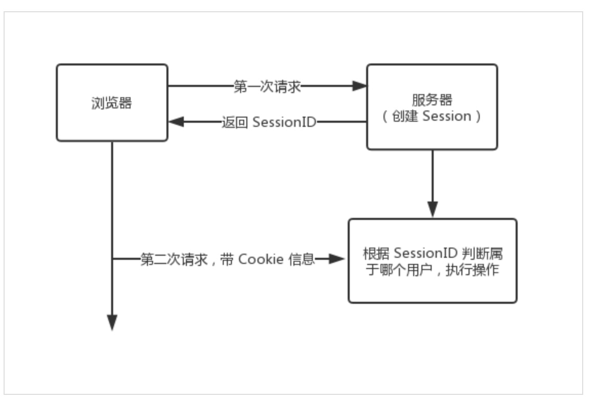

**工作原理**

- 浏览器第一次请求获取登录页面 login。
- 浏览器输入账号密码第二次请求，若输入正确，服务器响应浏览器一个 index 页面和一个键为 sessionid，值为随机字符串的 cookie，即 set_cookie ("sessionid",随机字符串)。
- 服务器内部在 django.session 表中记录一条数据。

django.session 表中有三个字段。

  - session_key：存的是随机字符串，即响应给浏览器的 cookie 的 sessionid 键对应的值。
  - session_data：存的是用户的信息，即多个 request.session["key"]=value，且是密文。
  - expire_date：存的是该条记录的过期时间（默认14天）
- 浏览器第三次请求其他资源时，携带 cookie :{sessionid:随机字符串}，服务器从 django.session 表中根据该随机字符串取出该用户的数据，供其使用（即保存状态）。

**注意:** django.session 表中保存的是浏览器的信息，而不是每一个用户的信息。 因此， 同一浏览器多个用户请求只保存一条记录（后面覆盖前面）,多个浏览器请求才保存多条记录。

cookie 弥补了 http 无状态的不足，让服务器知道来的人是"谁"，但是 cookie 以文本的形式保存在浏览器端，安全性较差，且最大只支持 4096 字节，所以只通过 cookie 识别不同的用户，然后，在对应的 session 里保存私密的信息以及超过 4096 字节的文本。

session 设置：

```python
request.session["key"] = value
```

执行步骤：

- a. 生成随机字符串
- b. 把随机字符串和设置的键值对保存到 django_session 表的 session_key 和 session_data 里
- c. 设置 `cookie：set_cookie("sessionid",随机字符串)` 响应给浏览器

session 获取：

```python
request.session.get('key')
```

执行步骤：

- a. 从 cookie 中获取 sessionid 键的值，即随机字符串。
- b. 根据随机字符串从 django_session 表过滤出记录。
- c. 取出 session_data 字段的数据。

session 删除，删除整条记录（包括 session_key、session_data、expire_date 三个字段）：

```python
request.session.flush()
```

删除 session_data 里的其中一组键值对：

```python
del request.session["key"]
```

执行步骤：

- a. 从 cookie 中获取 sessionid 键的值，即随机字符串
- b. 根据随机字符串从 django_session 表过滤出记录
- c. 删除过滤出来的记录

**修改视图函数逻辑实现非法拦截**

```python
def login(request):
    if request.method == 'GET':
        return render(request, 'login.html')
    else:
        username = request.POST['username']
        password = request.POST['password']
        user = User.objects.filter(username=username, password=password).first()

        if user is not None:
            # 在session中设置标记
            # request.session['is_login'] = True
            # request.session['username'] = user.username

            # 设置cookie 响应给客户端
            resp = redirect('/index/')
            resp.set_cookie('is_login', True)
            return resp
        else:
            return render(request, 'login.html', {'error': "Wrong username or password"})

def index(request):
    if request.method == 'GET':
        # 获取session中的标记
        # is_login = request.session.get('is_login', default=False)
        is_login = request.COOKIES.get('is_login')
        print(is_login)
        if not is_login:
            return redirect('/login/')
        # car_list = Car.objects.all().order_by('id')  # asc 升序
        car_list = Car.objects.all().order_by('-id')  # desc 降序
        return render(request, 'index.html', {'car_list': car_list})
```

<span style="color:#ff0009">**问题：如果需要保护的视图函数比较多，则以上方式实现比较繁琐，可以通过引入Django中间件解决**</span>

# Django 中间件

Django 中间件是修改 Django request 或者 response 对象的钩子，可以理解为是介于 HttpRequest 与 HttpResponse 处理之间的一道处理过程。

浏览器从请求到响应的过程中，Django 需要通过很多中间件来处理，可以看如下图所示：

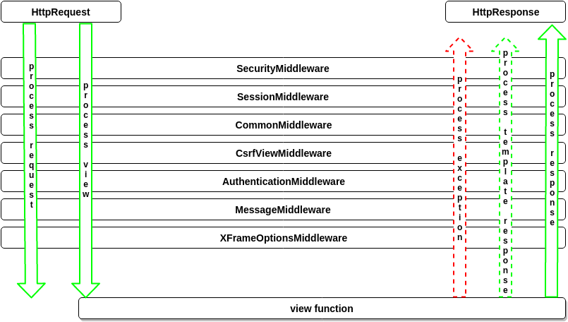

Django 中间件作用：

- 修改请求，即传送到 view 中的 HttpRequest 对象。
- 修改响应，即 view 返回的 HttpResponse 对象。

中间件组件配置在 settings.py 文件的 MIDDLEWARE 选项列表中。配置中的每个字符串选项都是一个类，也就是一个中间件。

**Django 默认的中间件配置：**

```python
MIDDLEWARE = [
    'django.middleware.security.SecurityMiddleware',
    'django.contrib.sessions.middleware.SessionMiddleware',
    'django.middleware.common.CommonMiddleware',
    'django.middleware.csrf.CsrfViewMiddleware',
    'django.contrib.auth.middleware.AuthenticationMiddleware',
    'django.contrib.messages.middleware.MessageMiddleware',
    'django.middleware.clickjacking.XFrameOptionsMiddleware',
]
```

### 自定义中间件

中间件可以定义四个方法，分别是：

```python
process_request(self,request)
process_view(self, request, view_func, view_args, view_kwargs)
process_exception(self, request, exception)
process_response(self, request, response)
```

**自定义中间件的步骤：**

在 app 目录下新建一个 py 文件，名字自定义，并在该 py 文件中导入 MiddlewareMixin：

```python
from django.utils.deprecation import MiddlewareMixin
```

**自定义的中间件类，要继承父类 MiddlewareMixin**:

```python
class MD1(MiddlewareMixin):
    pass
```

在 settings.py 中的 MIDDLEWARE 里注册自定义的中间件类:

```python
MIDDLEWARE = [
    'django.middleware.security.SecurityMiddleware',
    'django.contrib.sessions.middleware.SessionMiddleware',
    'django.middleware.common.CommonMiddleware',
    'django.middleware.csrf.CsrfViewMiddleware',
    'django.contrib.auth.middleware.AuthenticationMiddleware',
    'django.contrib.messages.middleware.MessageMiddleware',
    'django.middleware.clickjacking.XFrameOptionsMiddleware',
    'app_web01.middlewares.MD1',
]
```

**自定义中间件类的方法**

**自定义中间件类的方法有：process_request 和 process_response。**

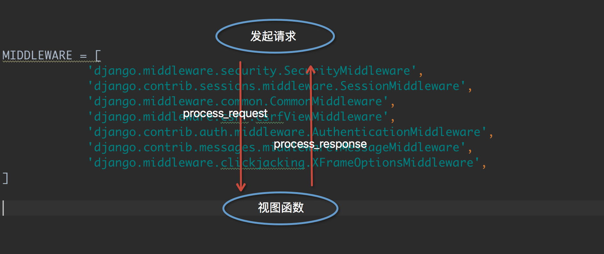

### process_request 方法

process_request 方法有一个参数 request，这个 request 和视图函数中的 request 是一样的。

process_request 方法的返回值可以是 None 也可以是 HttpResponse 对象。

- 返回值是 None 的话，按正常流程继续走，交给下一个中间件处理。
- 返回值是 HttpResponse 对象，Django 将不执行后续视图函数之前执行的方法以及视图函数，直接以该中间件为起点，倒序执行中间件，且执行的是视图函数之后执行的方法。
- process_request 方法是在视图函数之前执行的。
- 当配置多个中间件时，会按照 MIDDLEWARE中 的注册顺序，也就是列表的索引值，顺序执行。
- 不同中间件之间传递的 request 参数都是同一个请求对象。

```python
class MD1(MiddlewareMixin):
    def process_request(self, request):
       print("md1  process_request 方法。", id(request)) #在视图之前执行
```

### process_response

process_response 方法有两个参数，一个是 request，一个是 response，request 是请求对象，response 是视图函数返回的 HttpResponse 对象，该方法必须要有返回值，且必须是response。

process_response 方法是在视图函数之后执行的。

当配置多个中间件时，会按照 MIDDLEWARE 中的注册顺序，也就是列表的索引值，倒序执行

```python
class MD1(MiddlewareMixin):
    def process_request(self, request):
        print("md1  process_request 方法。", id(request)) #在视图之前执行

    def process_response(self,request, response): :#基于请求响应
        print("md1  process_response 方法！", id(request)) #在视图之后
        return response
```

# ModelForm组件

## ModelForm

```python
class UserForm(ModelForm):
    class Meta:
        model = User
        # 需要生成表单的属性
        fields = ('username', 'password', 'age', 'gender','role')
```

页面表单组件动态渲染

```htmldjango
<form style="padding: 10px" action="/app01/user/add" method="post">
    
     
        {{ field.label }}:{{ field }}
     
</form>
```

自定义校验规则

```python
class PrettyNumberForm(ModelForm):
    # 验证方式1
    """
    mobile = forms.CharField(
        label='手机号',
        validators=[RegexValidator(r'^1[3456789]\d{9}$','请填写正确的手机号')]
    )
    """

    class Meta:
        model = PrettyNumber
        fields = "__all__"

    # 验证方式2
    def clean_mobile(self):
        mobile = self.cleaned_data['mobile']
        if len(mobile) != 11:
            raise ValidationError('请输入11位的手机号')
        if not re.match(r'^1[3456789]\d{9}$', mobile):
            raise ValidationError('请输入正确的手机号')
        return mobile

    def __init__(self, *args, **kwargs):
        super().__init__(*args, **kwargs)
        for name, field in self.fields.items():
            field.widget.attrs = {'class': 'form-control', 'placeholder': field.label}
```

# 实战技巧

## 多app创建

在django项目根路径下创建一个apps目录，同时在该目录下创建后续的项目目录，比如项目中有用户管理模块，先创建一个use目录


<span style="color:#00a64e">执行以下命令，将app创建在该文件夹下</span>

```bash
python manage.py startapp user apps/user
```

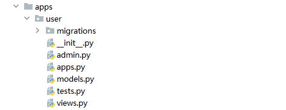

<span style="color:#00a64e">修改apps.py</span>

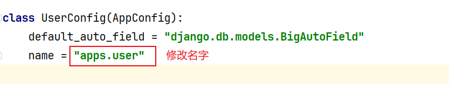

## 验证码图片

**安装插件**

```bash
pip install captcha
```

**设计工具**

```python
def generate_img_code(width=100,height=30):
    # 生成验证码文本
    captcha_text = ''.join(random.choices(string.ascii_lowercase.upper()+string.digits, k=4))
    # 创建图片对象
    image = ImageCaptcha(width, height, font_sizes=(25, 30, 35, 40))
    # 将图片转换为二进制
    data = image.generate(captcha_text)
    return data, captcha_text
```

**验证码返回前端**

```python
# 生成验证码
def generate_code(request):
    data, captcha = generate_img_code(100, 40)
    print(captcha)
    request.session['captcha'] = captcha
    return HttpResponse(data, content_type='image/png')
```

## 文件上传

**前端代码**

```htmldjango
<div class="container">
       <form method="post" ENCTYPE="multipart/form-data">
           
           <p><input type="text" name="username" placeholder="请输入用户名" class="form-control"></p>
           <p><input type="file" name="avator" class="form-control" ></p>
           <p><input type="submit" value="提交" class="form-control"></p>
       </form>
   </div>
```

**后台代码**

```python
def upload_list(request):
    if request.method == 'GET':
        return render(request, 'upload/upload_list.html')
    else:
        # 请求体中的数据
        print(request.POST)
        # 上传文件
        file_like_object = request.FILES.get('avator')
        with open('avator.png', 'wb+') as destination:
            for chunk in file_like_object.chunks():
                destination.write(chunk)
        return HttpResponse('上传', content_type='text/html; charset=utf-8')
```

**excel文件解析**

```python
import pandas as pd

file_like_object = request.FILES.get('excel')
df = pd.read_excel(file_like_object)
#改变字典key的名字
df.rename(columns={'id': 'id', '姓名': 'name', '年龄': 'age', '成绩': 'score', '入学时间': 'school_time'},
          inplace=True)
for index, row in df.iterrows():
    print(index, row.to_dict())
```

**解决跨域问题**

在Django中设置跨域通常是为了解决前端（如React、Angular或Vue等）应用与服务端（Django）之间的跨域资源共享（CORS）问题。Django本身不直接处理CORS，但你可以通过安装和使用第三方库如django-cors-headers来轻松实现CORS配置。

### 使用django-cors-headers

1. 安装**django-cors-headers**

   ```bash
   pip install django-cors-headers
   ```

2. 添加django-cors-headers到INSTALLED_APPS中：

   ```python
   INSTALLED_APPS = [    ...    'corsheaders',    ...]
   ```

3. 在Django的MIDDLEWARE配置中正确设置CorsMiddleware。通常，你应该将CorsMiddleware放在其他中间件之前

```python
MIDDLEWARE = [
    'corsheaders.middleware.CorsMiddleware',
    'django.middleware.common.CommonMiddleware',
    ...
]
```

**4. 配置CORS**

在settings.py中，你可以设置允许的源（origins），方法和头信息等。例如，如果你想要允许所有源，可以这样设置：

```python
CORS_ALLOW_ALL_ORIGINS = True
CORS_ALLOW_METHODS = [
    "DELETE",
    "GET",
    "OPTIONS",
    "PATCH",
    "POST",
    "PUT",
]
```

```python
CORS_ALLOW_HEADERS = [
    'accept',
    'accept-encoding',
    'authorization',
    'content-type',
    'dnt',
    'origin',
    'user-agent',
    'x-csrftoken',
    'x-requested-with',
    'x-token'  # 新增需允许的自定义请求头
]
```

## 日期控件数据回显

```python
from django import forms
class DateTimeInput(forms.DateTimeInput):
    input_type = 'datetime-local'
class EmpModelForm(ModelForm):
    class Meta:
        model = Emp
        fields = ['hire_date']
        widgets = {
            'hire_date': DateTimeInput(attrs={'class': 'form-control','format': '%Y-%m-%dT%H:%M'}),
        }
```

数据格式处理

```python
from datetime import datetime
hire_date = datetime.strftime(hire_date, '%Y-%m-%dT%H:%M')
```

**效果:**

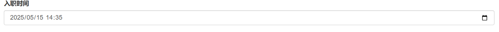
